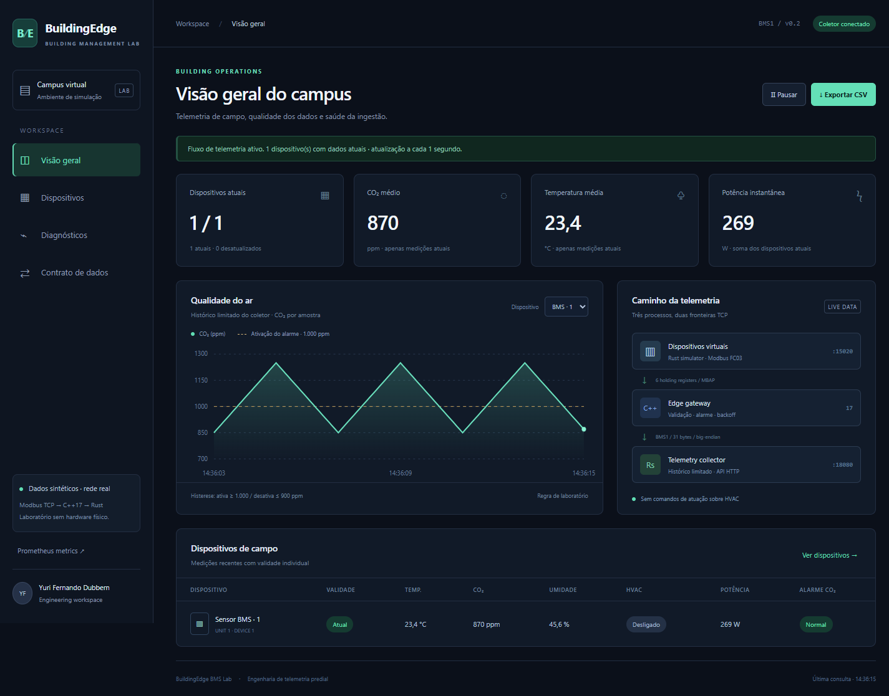
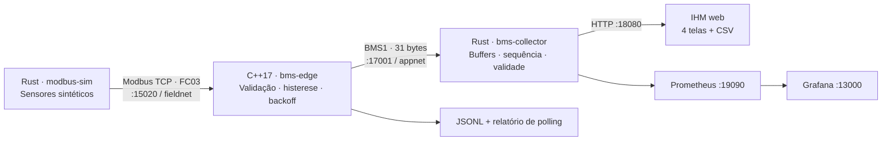
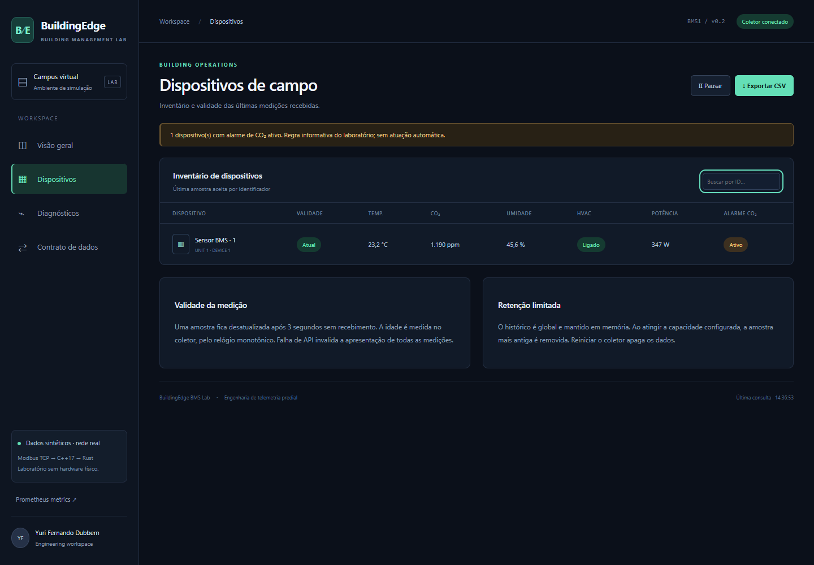
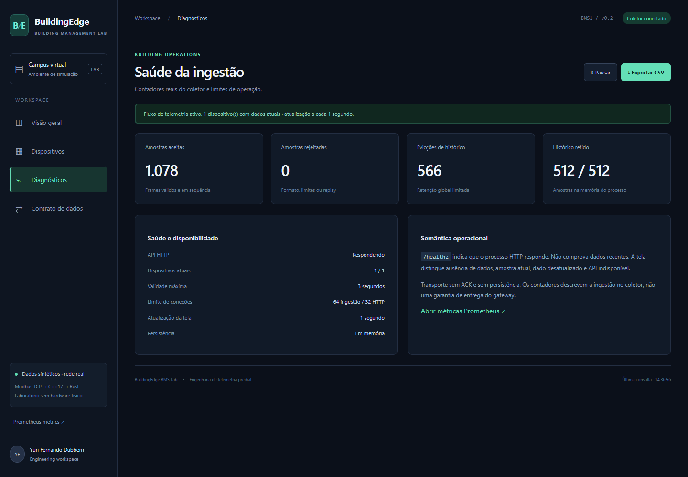
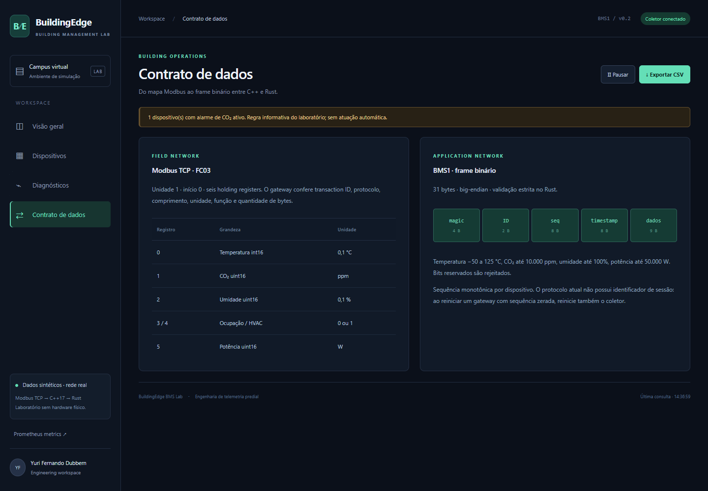
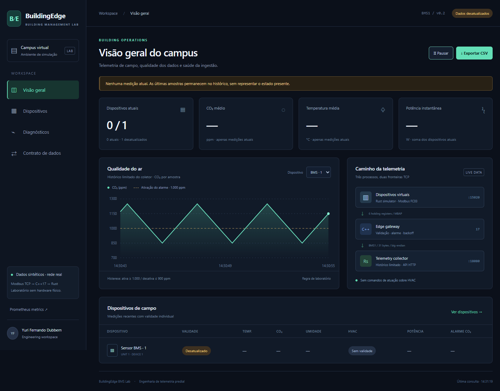
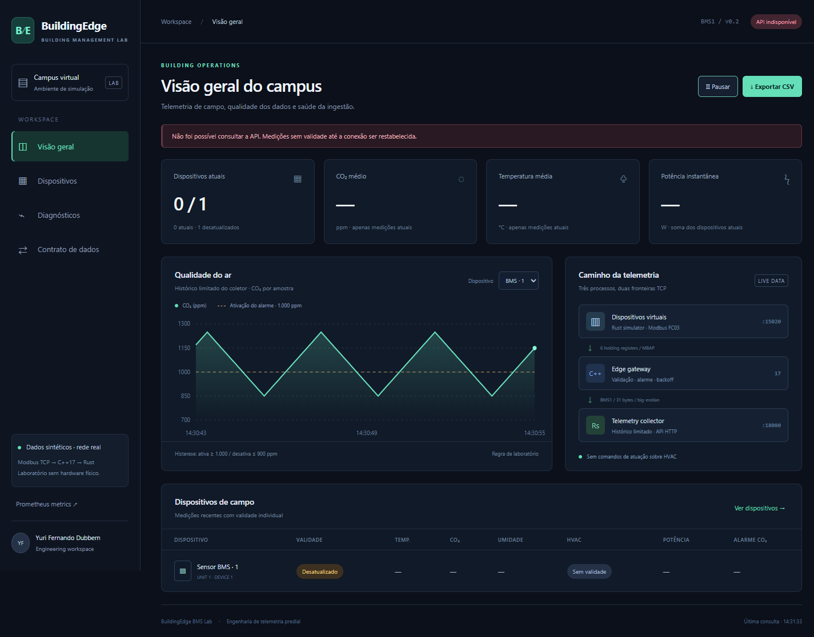
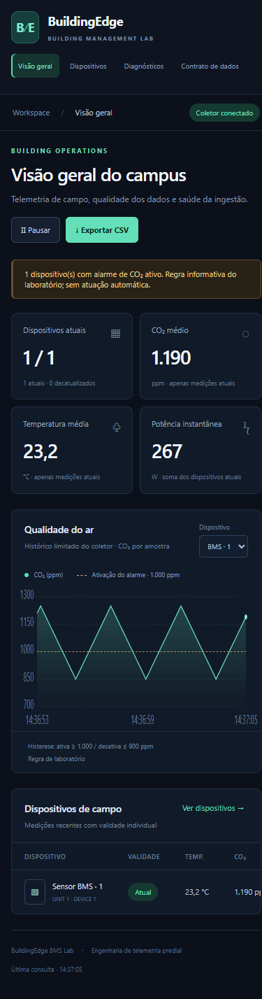
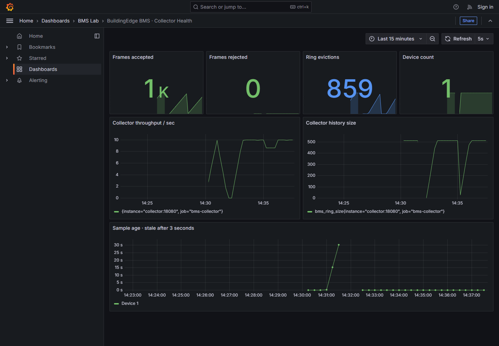
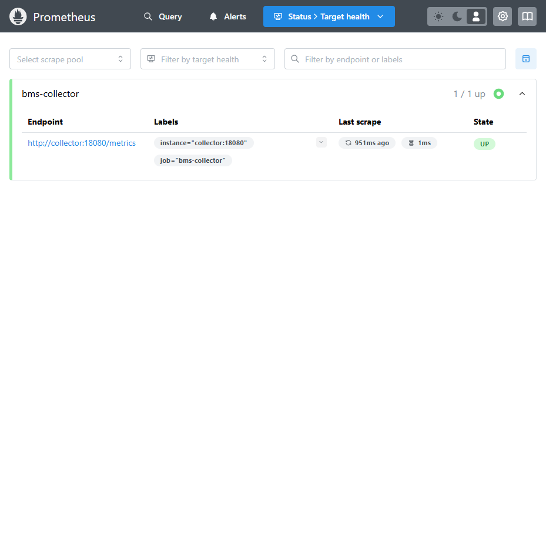

# 🏢 BuildingEdge BMS Lab — Telemetria Predial de Ponta a Ponta em C++17 e Rust

### C++17 · Rust 2021 · Modbus TCP · Protocolo binário BMS1 · IHM Web · Prometheus · Grafana · Docker Compose

[](https://github.com/Yuri-Fernando/BuildingEdge-BMS-Lab/actions/workflows/ci.yml)


**Laboratório de engenharia de software para sistemas de gestão predial:** aquisição Modbus real, validação de dados, alarme com histerese, recuperação de falhas, transporte binário entre linguagens e supervisão com validade explícita das medições.

<p align="center">
  <a href="docs/images/overview.png"></a>
  <br><sub>IHM servida pelo coletor Rust. Dados sintéticos produzidos pelo simulador, coletados pelo gateway C++ por Modbus TCP e recebidos pelo coletor via BMS1.</sub>
</p>

## Status

🟡 **Em desenvolvimento — MVP técnico funcional v0.2.0.** Núcleo validado em Docker e no [GitHub Actions, em Linux e Windows](https://github.com/Yuri-Fernando/BuildingEdge-BMS-Lab/actions/runs/43922538630). A aplicação possui três processos, uma IHM de quatro telas e uma suíte de contratos de rede. O relatório da execução atual está em [Evidências](docs/EVIDENCE.md). O código não controla equipamentos físicos.

| Frente | Implementação | Verificação |
|---|---|---|
| Aquisição Modbus TCP FC03 | Gateway C++17 com socket persistente e reconexão | CTest, oráculo TCP Python e simulador Rust |
| Contrato entre linguagens | Frame BMS1, 31 bytes big-endian | Serialização C++, parser Rust e integração real |
| Agregação e histórico | Rust sem crates externas; limites de memória e dispositivos | Testes unitários e testes HTTP/TCP |
| IHM | Visão geral, dispositivos, diagnósticos e contrato | Navegação, responsividade, CSV e estados de falha |
| Observabilidade | API de leitura, métricas Prometheus e dashboard Grafana | Evidências e comandos no manual operacional |
| Empacotamento | Docker Compose com redes separadas, usuário sem privilégios e limites de recursos | Build e execução dos serviços |
| CI hospedado | ✅ Três jobs aprovados: C++/sanitizers, Rust/integração Linux e Rust/contratos Windows | [Execução do commit b759568](https://github.com/Yuri-Fernando/BuildingEdge-BMS-Lab/actions/runs/43922538630) |
| Limites do produto | Sem ACK, persistência, TLS, autenticação ou hardware real | Escopo documentado e roadmap técnico |

---

## Descrição / Contexto

Um BMS (*Building Management System*) precisa transformar leituras de campo em dados que um operador possa interpretar com confiança. Isso envolve mais do que mostrar números: um frame pode chegar pela metade, um sensor pode devolver valores impossíveis, um socket pode cair e uma medição antiga pode continuar aparecendo na tela.

O BuildingEdge implementa esse caminho em um ambiente reproduzível. O simulador Rust responde a requisições Modbus TCP; o gateway C++17 valida as respostas, converte as grandezas, calcula um alarme informativo de CO₂ e envia um frame binário ao coletor Rust. O coletor mantém dados em memória, aplica limites e expõe a IHM e os endpoints de consulta.

O trecho de campo usa o protocolo industrial Modbus TCP. O trecho entre gateway e coletor usa um contrato próprio, pequeno e versionado, para tornar explícitos os problemas de interoperabilidade entre C++ e Rust. A planta é sintética; sockets, processos, timeouts, validações e falhas são reais.

---

## 🧭 Origem do Projeto

O projeto parte de uma questão de engenharia: **como desenvolver um backend de telemetria predial verificável quando não há dispositivos físicos disponíveis?**

O [Industrial Control Lab](https://github.com/Yuri-Fernando/Industrial-Control-Lab) demonstra controle de processo, soft-PLC e intertravamentos. O BuildingEdge explora outra responsabilidade: aquisição, qualidade, agregação e apresentação dos dados. Ele não replica o controlador do projeto anterior.

As decisões centrais foram:

1. Separar simulação, gateway e coleta em processos independentes, para exercitar fronteiras de rede reais.
2. Manter o mapa Modbus pequeno e explícito, com validação de protocolo e de grandezas.
3. Escrever um receptor Rust que interprete os bytes produzidos pelo C++, sem compartilhar o parser do emissor.
4. Limitar buffers, dispositivos e conexões, tornando a retenção e a capacidade observáveis.
5. Distinguir saúde do processo, disponibilidade da API e atualidade da medição.
6. Documentar capacidades demonstradas e pendências com evidências reproduzíveis.

A revisão da v0.2 adicionou uma camada operacional: IHM, histórico consultável, exportação e tratamento visual de dados desatualizados. As fontes primárias consultadas e os trade-offs estão em [Pesquisa e decisões](docs/RESEARCH.md).

---

## 🎯 Objetivo

- Coletar seis grandezas por Modbus TCP FC03 e validar todo o envelope antes de aceitar uma amostra.
- Demonstrar comunicação binária C++ → Rust com contrato estável e limites compartilhados.
- Recuperar a aquisição após desconexões, sem produzir medições válidas a partir de respostas inválidas.
- Expor histórico e estado atual sem crescimento ilimitado de memória.
- Mostrar ao operador quando uma medição deixou de representar o presente.
- Entregar execução local, containers, testes automatizados, documentação e imagens da aplicação.
- Medir latência de polling com escopo e ambiente identificados.

---

## 🔬 Linha de Pesquisa / Desenvolvimento

| Tema | Questão explorada | Implementação |
|---|---|---|
| Redes industriais | Como validar respostas Modbus em um fluxo TCP? | MBAP, TID, unidade, função, byte count e leitura exata |
| Interoperabilidade | Como preservar tipos e offsets entre duas linguagens? | BMS1, big-endian, frame de tamanho fixo |
| Resiliência | O que acontece após uma conexão cair? | Fechamento do socket, backoff e nova tentativa |
| Qualidade de dados | Um número recebido ainda representa o presente? | Idade monotônica por dispositivo e invalidação na IHM |
| Recursos limitados | Como impedir retenção e concorrência sem limite? | Rings, teto de IDs e permits de conexão |
| Observabilidade | Qual parte da cadeia está saudável? | JSONL, métricas de polling, API e Prometheus |
| Verificação | Como evitar que emissor e receptor repitam o mesmo erro? | Oráculo Python independente e integração entre binários reais |

---

## 🏗️ Arquitetura



### Responsabilidades

| Componente | Responsabilidade | Limites |
|---|---|---|
| `modbus-sim` | Servir seis registradores; variar dados determinísticos; injetar atraso e desconexão | Até 64 conexões; somente o mapa FC03 definido |
| `bms-edge` | Ler, validar, aplicar histerese, guardar observações locais e transmitir BMS1 | Ring configurável; últimas 2.048 latências; transmissão best effort |
| `bms-collector` | Validar frames, rejeitar replay, agregar últimos valores e histórico | Até 128 dispositivos; 1–65.536 amostras; 64 conexões de ingestão e 32 HTTP |
| IHM | Consultar a API, apresentar validade, desenhar histórico e exportar CSV | Sem chamadas externas, bundler ou framework |
| Prometheus / Grafana | Coletar contadores e apresentar a saúde da ingestão | Extensão opcional do laboratório |

No Compose, o gateway participa de duas redes internas. Uma terceira rede bridge de supervisão permite publicar a IHM e a observabilidade no loopback do host. O simulador fica na rede de campo; o coletor e a observabilidade, na rede de aplicação. Apenas endpoints HTTP de supervisão são publicados no loopback do host.

Mais detalhes, fluxo de erros e ADRs: [Arquitetura](docs/ARCHITECTURE.md).

---

## ⚙️ Funcionamento

1. O gateway estabelece uma conexão com o servidor Modbus e envia FC03: unidade 1, início 0, seis registradores.
2. Ele lê exatamente o cabeçalho e o payload, validando TID, protocolo, comprimento, unidade, função e quantidade.
3. A conversão aplica a escala de temperatura e umidade e rejeita grandezas fora dos limites.
4. O alarme de CO₂ ativa em **1.000 ppm** e desativa em **900 ppm**. Entre os limites, mantém seu estado anterior.
5. A amostra recebe identificador, sequência e timestamp e entra no buffer local.
6. O gateway serializa os 31 bytes BMS1 e os envia ao coletor. Uma falha nessa etapa não invalida a aquisição Modbus já concluída.
7. O coletor valida o frame e a sequência por dispositivo. Ao atingir a capacidade do histórico global, remove a amostra mais antiga.
8. A IHM consulta dados a cada segundo. Após **3 segundos sem recebimento**, apresenta o dispositivo como desatualizado e retira sua medição dos indicadores atuais.
9. Se a API fica indisponível, a IHM invalida a apresentação das medições até restabelecer a conexão. O histórico permanece identificado como histórico.

O estado de HVAC é um dado lido. A aplicação não envia comandos de atuação.

---

## 📡 Dados e Contratos

### Mapa Modbus

| Registro | Grandeza | Tipo no protocolo | Escala / exemplo | Faixa aceita |
|---:|---|---|---|---|
| 0 | Temperatura | int16 | 235 → 23,5 °C | −50 a 125 °C |
| 1 | CO₂ | uint16 | 1.020 → 1.020 ppm | 0–10.000 ppm |
| 2 | Umidade relativa | uint16 | 450 → 45,0% | 0–100% |
| 3 | Ocupação | uint16 | 0 / 1 | Booleano estrito |
| 4 | HVAC ligado | uint16 | 0 / 1 | Booleano estrito |
| 5 | Potência instantânea | uint16 | 500 → 500 W | 0–50.000 W |

O cliente é específico para esse contrato; isso não equivale à compatibilidade com qualquer mapa de fabricante.

### Frame BMS1

```text
0         4     6             14            22    24    26    28 29   31
┌─────────┬─────┬──────────────┬──────────────┬─────┬─────┬─────┬──┬────┐
│ "BMS1"  │ ID  │ sequência    │ Unix ms      │temp │ CO₂ │ RH  │fl│ W  │
│ 4 bytes │ 2 B │ 8 bytes      │ 8 bytes      │ 2 B │ 2 B │ 2 B │1B│ 2B │
└─────────┴─────┴──────────────┴──────────────┴─────┴─────┴─────┴──┴────┘
```

Todos os inteiros são big-endian. Flags: bit 0 ocupação, bit 1 HVAC e bit 2 alarme. Bits reservados, ID zero, sequência zero e valores impossíveis são rejeitados.

O JSON representa a sequência como **string**, preservando os 64 bits em clientes JavaScript. O frame binário permanece compatível com BMS1.

Contrato completo e exemplos de API: [Protocolo](docs/PROTOCOL.md).

---

## 🖥️ Aplicação

| Tela | Uso |
|---|---|
| **Visão geral** | Dispositivos atuais, CO₂ médio, temperatura média, potência instantânea, histórico e caminho da telemetria |
| **Dispositivos** | Inventário, busca por ID, validade individual, HVAC e alarme |
| **Diagnósticos** | Aceitação, rejeição, evicções, retenção e semântica de disponibilidade |
| **Contrato de dados** | Mapa Modbus, campos BMS1, faixas e limitação de reinício de sequência |

O gráfico mostra as últimas 120 amostras do dispositivo selecionado dentro do histórico disponível. Seu eixo horizontal distribui as amostras em ordem; os rótulos mostram timestamps do emissor. Não é uma integração de energia nem uma série persistida.

**Exportar CSV** baixa o histórico consultado, com ID, sequência, timestamp, temperatura, CO₂, umidade, ocupação, HVAC, alarme e potência. A pausa interrompe as consultas; a validade continua expirando pelo tempo transcorrido.

---

## 🧠 Verificação / Modelagem

### Reproduzir a suíte completa em Docker

```bash
docker build -f docker/Dockerfile.validation -t buildingedge-validation .
docker run --rm buildingedge-validation
```

### Reproduzir por ferramenta

```bash
cargo fmt --manifest-path rust/Cargo.toml --check
cargo clippy --manifest-path rust/Cargo.toml --all-targets -- -D warnings
cargo test --manifest-path rust/Cargo.toml --locked

ctest --test-dir build --output-on-failure
python3 scripts/integration.py --mode python
python3 scripts/integration.py --mode rust
python3 scripts/system_tests.py
python3 scripts/fault_tests.py
```

| Camada | O que verifica |
|---|---|
| CTest | Ring, histerese, backoff, Modbus, serialização, limites e percentis |
| Cargo | Parser BMS1, rejeição de dados inválidos, replay, ring e liberação de permits |
| Integração Python | C++ contra dois servidores TCP independentes: cenário normal e desconexões periódicas |
| Integração Rust | C++ contra os serviços Rust reais, incluindo snapshot HTTP e métricas |
| Contratos do coletor | Assets, API vazia, histórico limitado, replay, fragmentação, stale, métodos e recuperação de capacidade HTTP |
| Falhas do gateway | TID, unidade, exceção, length, truncamento, grandeza inválida e resposta TCP fragmentada |
| Browser | Navegação, busca, pausa, CSV, viewport móvel e apresentação dos estados atual/stale/offline |

Para ASan/UBSan:

```bash
cmake -S . -B build-asan -DCMAKE_BUILD_TYPE=Debug -DBMS_SANITIZE=ON
cmake --build build-asan --parallel 2
ctest --test-dir build-asan --output-on-failure
```

Os logs e medições da revisão ficam em [docs/evidence](docs/evidence/). Os testes de capacidade verificam que os permits são recuperados; não equivalem a um benchmark de carga ou teste de resistência em produção.

---

## 🧪 Desenvolvimento Experimental

A v0.2 foi organizada em revisão de contratos, mudanças no backend, IHM, testes de rede, build de containers e verificação visual.

Achados tratados nesta revisão:

- **Validação assimétrica:** o encoder C++ aceitava ID zero, sequência zero e potência acima de 50.000 W, enquanto o parser Rust rejeitava esses valores. Os limites foram alinhados e ganharam regressões.
- **HTTP fragmentado:** uma única chamada `read` não garante receber a linha de requisição inteira. O coletor passou a acumular headers com limite de tamanho e deadline.
- **Threads sem teto:** os servidores Rust criavam uma thread por conexão. Permits com liberação por RAII agora limitam a concorrência.
- **Medição antiga sem validade explícita:** o snapshot ganhou idade de recebimento monotônica e a IHM passou a retirar dados vencidos dos indicadores atuais.
- **Runtime C++ da imagem:** a compilação com GCC 14 e execução no Debian Bookworm exigiam atenção à versão da libstdc++. O executável da imagem passou a incluir o runtime C++ estaticamente.
- **Acesso local no Docker:** as redes internas mantinham a aquisição ativa, mas não publicavam o HTTP no host neste ambiente. Foi adicionada uma rede bridge de supervisão; as portas continuam em 127.0.0.1.
- **Execução do serviço:** o gateway tinha somente número finito de tentativas. `--rounds 0` passou a expressar execução contínua no Compose.
- **Material de portfólio:** anotações pessoais, handoff, arquivos de auditoria antiga e ZIP foram preservados localmente e excluídos do versionamento.

---

## 🛠️ Tecnologias

**Produto:** C++17 / STL, Rust 2021 / biblioteca padrão, HTML, CSS e JavaScript. Sem crates externas e sem pacotes npm em runtime.

**Protocolos:** Modbus TCP FC03, BMS1, HTTP/1.1 de escopo limitado, exposição Prometheus.

**Build e testes:** CMake, CTest, Cargo, rustfmt, Clippy, Python padrão, sockets e processos reais.

**Infraestrutura:** Docker Compose, imagens multi-stage, Prometheus, Grafana OSS e GitHub Actions.

**IHM:** assets embutidos no binário Rust, mesma origem, sem CDN, gráfico SVG, busca e exportação local.

---

## 📊 Resultados

| Verificação executada | Resultado | Origem |
|---|---|---|
| Contratos do núcleo C++ | 1 executável CTest aprovado, também com ASan/UBSan | Logs de validação e job cpp-linux |
| Testes unitários Rust | 5 aprovados | Cargo e CI Linux/Windows |
| Integração com sockets reais | 4 cenários: normal/falha × referência Python/serviços Rust | Testes finais |
| Contratos externos do coletor | 6 aprovados | system_tests.py, incluindo Windows no CI |
| Falhas do gateway | 7 aprovadas | fault_tests.py |
| Cenário sem falhas | 80/80 leituras válidas, nos dois modos de integração | Logs de integração |
| Desconexão a cada 7 requisições | 69 leituras válidas e 11 erros tratados por cenário | Logs de integração |
| CI hospedado | 3/3 jobs aprovados | Execução b759568 |
| Evidências visuais | 11 capturas reais | docs/images |
| Exportação pela IHM | CSV com 512 amostras conferidas | telemetry-export.csv |

O CTest agrupa seus asserts em um executável; os cenários de integração e os jobs de CI não são somados como se fossem testes unitários independentes. Percentis e ambiente estão no relatório de evidências.

A revisão atual publica evidências separadas por camada em [docs/EVIDENCE.md](docs/EVIDENCE.md), com ambiente, comandos, resultados e limites. Nenhuma latência é tratada como SLA e nenhum resultado em container comprova operação em hardware de campo.

Métricas produzidas pelo gateway:

| Campo | Interpretação |
|---|---|
| `poll_success` | Leituras aceitas depois da validação |
| `modbus_errors` | Erros de transporte ou envelope Modbus |
| `validation_errors` | Respostas com grandezas inválidas |
| `collector_errors` | Falhas percebidas pelo envio TCP |
| `ring_evictions` | Observações removidas do buffer local |
| `poll_p50_us / p95 / p99` | Percentis da janela de latências Modbus |
| `latency_sample_count` | Quantidade de amostras usada nos percentis |

Métricas do coletor incluem contadores de aceitação/rejeição/evicção, tamanho do histórico, dispositivos conhecidos e `bms_device_sample_age_seconds{device="…"}`.

---

## 🖼️ Evidências

Capturas da aplicação executada com dados sintéticos percorrendo os três processos. A galeria inclui operação, dispositivos, diagnósticos, contrato, mobile, pausa, ausência de dados, aquisição interrompida, API indisponível e observabilidade.

### Telas e estados operacionais

<p align="center">
  <a href="docs/images/devices.png"></a>
  <a href="docs/images/diagnostics.png"></a>
  <br><sub>Inventário e diagnósticos.</sub>
</p>
<p align="center">
  <a href="docs/images/protocol.png"></a>
  <a href="docs/images/stale.png"></a>
  <br><sub>Contrato e tratamento de perda da aquisição.</sub>
</p>
<p align="center">
  <a href="docs/images/offline.png"></a>
  <a href="docs/images/mobile.png"></a>
  <br><sub>Falha de API e apresentação responsiva.</sub>
</p>

### Observabilidade

<p align="center"><a href="docs/images/grafana.png"></a></p>
<p align="center"><a href="docs/images/prometheus.png"></a></p>

### Arquivos de evidência

| Evidência | O que permite conferir |
|---|---|
| [Galeria completa](docs/images/README.md) | As 11 capturas reais, com contexto de cada estado |
| [Relatório técnico](docs/EVIDENCE.md) | Ambiente, resultados, escopo e limites das medições |
| [Testes finais](docs/evidence/final-validation-tests.log) | CTest, integração Python/Rust e contratos de rede |
| [Falhas e sanitizers](docs/evidence/fault-sanitizer-tests.log) | Recuperação Modbus e ASan/UBSan |
| [Verificação de browser](docs/evidence/browser-verification.md) | Navegação, busca, CSV, validade e mobile |
| [Exportação CSV](docs/evidence/telemetry-export.csv) | 512 amostras sintéticas exportadas pela aplicação |
| [CI publicado](https://github.com/Yuri-Fernando/BuildingEdge-BMS-Lab/actions/runs/43922538630) | Três jobs aprovados no GitHub |

---

## 🚀 Aplicações

- Estudo de aquisição industrial/predial, telemetria e integração C++/Rust.
- Demonstração de contratos binários, qualidade de dados e recuperação de falhas.
- Base para ensaiar um coletor de edge antes de integrar dispositivos físicos.
- Exercícios de observabilidade, testes de protocolo e diagnóstico de sistemas distribuídos.

---

## 🔭 Visão de Longo Prazo

Evoluir de uma bancada de aquisição validada para uma plataforma experimental de edge predial com qualidade de dados rastreável, múltiplos dispositivos e recuperação explícita de falhas.

A sequência técnica prioriza sessão e identidade do emissor, entrega com ACK e persistência, isolamento de links lentos e medição sob carga. A integração com hardware e novos protocolos deve vir acompanhada de fixtures, limites publicados e testes de conformidade adequados.

```text
aquisição e supervisão validadas
  → sessão BMS2 e recuperação de reinício
  → ACK, spool e deduplicação
  → vários dispositivos com isolamento de falhas
  → identidade, TLS e retenção durável
  → adapters e validação em hardware identificado
```

Essa é a direção de desenvolvimento. Os itens seguintes permanecem planejados, com critérios de aceitação no roadmap.

---

## 🗺️ Roadmap

| Evolução | Critério de aceitação |
|---|---|
| Sessão explícita em BMS2 | Reinício do gateway sem rejeitar indefinidamente a nova sequência; migração de contrato testada |
| ACK e spool durável | Reconexão, duplicação, recuperação após crash e política de retenção verificadas |
| Vários dispositivos em paralelo | Um link lento não bloqueia os demais; limites de CPU/RSS e p99 publicados |
| Deadline completo de rede | DNS/connect/read/write com orçamento total e testes de destino indisponível |
| Identidade e TLS | Autenticação por dispositivo, autorização e rotação de credenciais |
| Fuzzing e carga | Corpus reproduzível, sanitizers e testes de saturação longa |
| Adapters adicionais | BACnet/IP ou KNX com bibliotecas adequadas e fixtures de conformidade |
| Hardware edge | Build e medições em plataforma identificada, sem extrapolar resultados do notebook |

Detalhamento: [ROADMAP.md](ROADMAP.md).

---

## 🕓 Histórico e Mudanças

| Versão / marco | Data | O que mudou |
|---|---|---|
| v0.1.0 — baseline | 14/11/2026 | Gateway C++17, mapa Modbus FC03, contrato BMS1, código dos serviços Rust, testes do núcleo e integração de referência Python |
| v0.2.0 — operação e validação | 16/11/2026 | IHM com quatro telas, histórico/CSV, validade monotônica, limites de conexões, testes HTTP/TCP e falhas, Docker e observabilidade executados, 11 capturas e documentação técnica |
| Publicação e apresentação | 16/11/2026 | Repositório público, CI aprovado em Linux/Windows, tópicos GitHub, status de desenvolvimento e alinhamento das seções ao padrão do portfólio |

Histórico detalhado: [CHANGELOG.md](CHANGELOG.md). Achados, correções e pendências: [Revisão técnica](docs/QUALITY_REVIEW.md).

---

## 🔮 Próximos Passos

**Concluído nesta versão:** pipeline C++ → Rust executado, interface e observabilidade conectadas a dados reais do laboratório, testes locais e CI hospedado aprovados, documentação e capturas publicadas.

**Próximos técnicos:**

1. Introduzir sessão explícita em BMS2 para recuperar reinícios do gateway sem conflito de sequência.
2. Definir o contrato de ACK, spool durável e deduplicação antes de prometer recuperação de entrega.
3. Implementar e testar orçamento global de DNS/connect/read/write.
4. Medir CPU, RSS e p99 com vários dispositivos e links lentos isolados.
5. Definir identidade, TLS e política de retenção antes de ampliar a exposição de rede.

**Dependem de infraestrutura ou equipamento:** ensaios com dispositivos físicos, validação em plataforma edge identificada e adapters BACnet/KNX com fixtures apropriadas. Não são capacidades concluídas.

---

## ▶️ Como rodar localmente

### Opção recomendada: Docker Compose

Pré-requisitos: Git, Docker Engine/Desktop com containers Linux e Docker Compose v2. O primeiro build baixa imagens públicas e ferramentas de compilação.

```bash
git clone https://github.com/Yuri-Fernando/BuildingEdge-BMS-Lab.git
cd BuildingEdge-BMS-Lab
docker compose up -d --build
docker compose ps
```

Abra **[http://localhost:18080](http://localhost:18080)**. Aguarde alguns segundos para a primeira conexão do gateway.

```bash
curl http://localhost:18080/healthz
curl http://localhost:18080/v1/latest
curl http://localhost:18080/v1/history
curl http://localhost:18080/metrics
docker compose logs --tail 30 gateway collector
docker compose down
```

O gateway usa `--rounds 0` para execução contínua. Os containers têm usuário sem privilégios, filesystem somente leitura, capabilities removidas, limite de processos, 128 MiB de memória, uma CPU e rotação dos logs.

### Linux / WSL2: compilação nativa

Pré-requisitos: GCC ≥ 10, CMake ≥ 3.16, Rust ≥ 1.75 e Python ≥ 3.9. O gateway usa sockets POSIX; no Windows, a stack completa roda em containers Linux. Os serviços Rust também podem ser compilados para Windows com um toolchain completo.

```bash
cmake -S . -B build -DCMAKE_BUILD_TYPE=Debug -DBUILD_TESTING=ON
cmake --build build --parallel 2
ctest --test-dir build --output-on-failure
cargo test --manifest-path rust/Cargo.toml --locked
cargo build --manifest-path rust/Cargo.toml --locked
```

Abra três terminais:

```bash
# 1 — servidor Modbus
./rust/target/debug/modbus-sim --port 15020

# 2 — coletor + IHM
./rust/target/debug/bms-collector --ingest-port 17001 --http-port 18080 --capacity 512

# 3 — gateway contínuo
./build/bms-edge --host 127.0.0.1 --port 15020 \
  --collector 127.0.0.1 --collector-port 17001 \
  --poll-ms 100 --rounds 0 --ring-capacity 256
```

Para encerrar o gateway, use Ctrl+C. Para uma execução medida e finita:

```bash
./build/bms-edge --rounds 1000 --poll-ms 10 \
  --metrics-file benchmarks/last-run.json
```

O polling mede solicitação/resposta Modbus, não a latência total até a tela. `--poll-ms` é a espera entre tentativas; não é um período rígido de scan.

### Observabilidade opcional

```bash
docker compose -f docker-compose.yml -f docker-compose.observability.yml up -d --build
```

| Serviço | Endereço local |
|---|---|
| IHM e API | [localhost:18080](http://localhost:18080) |
| Prometheus | [localhost:19090](http://localhost:19090) |
| Grafana | [localhost:13000](http://localhost:13000) |

O Grafana provisiona o dashboard **BuildingEdge BMS · Collector Health** com ingestão, rejeição, evicções, quantidade de dispositivos, throughput e histórico. O acesso anônimo é somente de leitura; as portas ficam restritas ao loopback.

O Docker Desktop pode não montar configurações diretamente de uma unidade virtual do Google Drive. Nesse caso, use um checkout em disco local para executar os containers e mantenha seu repositório original como fonte oficial.

---

## 📁 Estrutura do repositório

```text
BuildingEdge-BMS-Lab/
├── cpp/
│   ├── include/bms/                 # modelos, ring e interfaces de rede
│   ├── src/                         # core, sockets e gateway
│   └── tests/                       # contratos do núcleo
├── rust/
│   └── src/
│       ├── lib.rs                   # BMS1, store e permits
│       └── bin/                     # simulator e collector
├── web/                             # IHM embutida no coletor
├── scripts/                         # integração, falhas e contratos HTTP/TCP
├── docker/                          # imagens de runtime e validação
├── observability/                   # Prometheus e provisionamento Grafana
├── docs/
│   ├── images/                      # capturas reais da aplicação
│   ├── evidence/                    # logs, snapshots e hashes
│   └── *.md                         # engenharia, operação e estudo
├── .github/workflows/ci.yml
├── CMakeLists.txt
├── docker-compose*.yml
├── CHANGELOG.md
└── README.md
```

---

## 📚 Documentação

| Documento | Conteúdo |
|---|---|
| [Arquitetura](docs/ARCHITECTURE.md) | Componentes, fluxo de erros e decisões |
| [Protocolo](docs/PROTOCOL.md) | Offsets, regras, reinício de sequência e API |
| [Requisitos](docs/REQUIREMENTS.md) | Requisitos técnicos rastreados a código e testes |
| [Operação](docs/OPERATIONS.md) | Inicialização, falhas, recuperação e diagnóstico |
| [Guia de estudo](docs/CODE_GUIDE.md) | Organização do código e roteiro para reproduzir |
| [Revisão técnica](docs/QUALITY_REVIEW.md) | Diagnóstico, correções e pendências priorizadas |
| [Pesquisa](docs/RESEARCH.md) | Fontes oficiais e decisões derivadas |
| [Evidências](docs/EVIDENCE.md) | Resultados e contexto de validação |
| [Segurança e limites](docs/SECURITY.md) | Modelo de exposição e pendências |
| [Histórico](CHANGELOG.md) | Mudanças por versão |
| [Contribuição](CONTRIBUTING.md) | Regras para alterar contratos e validar mudanças |

---

## ⚠️ Limitações

- Sensores e estados são sintéticos. Não há hardware real, certificação, integração de fabricante ou instalação comercial demonstrada.
- BMS1 não possui session ID. Se um gateway reinicia e volta à sequência 1, o coletor rejeita os novos números até ultrapassarem a sequência anterior; para uma sessão limpa, reinicie também o coletor.
- O transporte não tem ACK de aplicação, armazenamento durável ou garantia exactly once. Os buffers em memória não constituem fila de reenvio.
- A API não tem TLS, autenticação ou autorização. O HTTP implementado atende somente as rotas do laboratório, sem pretensão de servidor HTTP público geral.
- Os limites de conexão reduzem consumo ilimitado de threads; não substituem proteção contra DoS distribuído, quotas por identidade ou testes de carga.
- O connect e a resolução de nomes do cliente C++ ainda dependem de comportamentos do sistema operacional; não existe deadline global de toda a operação.
- A IHM mostra potência instantânea em W. Não calcula consumo acumulado em kWh.
- A idade da medição usa o relógio de recebimento; timestamps do emissor são preservados como dados, sem normalização ou certificação temporal.
- O alarme de CO₂ é uma regra informativa do laboratório. Não é orientação de saúde nem uma função de segurança ou atuação automática.

---

## Status

🟡 **Em desenvolvimento — MVP técnico funcional v0.2.0.** Aquisição Modbus, gateway C++17, serviços Rust, IHM e observabilidade verificados em laboratório, com CI aprovado em Linux e Windows. Pendentes: sessão de emissor, entrega durável, autenticação/TLS, carga prolongada e hardware real.

---

## Contexto / Observações

Projeto independente de portfólio e pesquisa aplicada em software de automação predial. Dados, ocupação e estados de HVAC são sintéticos; não há instalação comercial, integração de fabricante ou certificação demonstrada.

As métricas descrevem execuções identificadas de laboratório. O alarme de CO₂ é uma regra informativa sem atuação automática. Notas pessoais e material de planejamento não integram a publicação.

---

## 🔗 Projetos Relacionados

| Projeto | Relação |
|---|---|
| [Industrial Control Lab](https://github.com/Yuri-Fernando/Industrial-Control-Lab) | Controle de processo, soft-PLC e intertravamentos |
| [ChampionCHIP](https://github.com/Yuri-Fernando/championchip-rv32-sky130) | Projeto de hardware digital e validação de contratos em outra camada |
| [ReconPilot AI](https://github.com/Yuri-Fernando/reconpilot-ai) | Validação determinística e rastreabilidade em domínio financeiro |

---

## 🤖 Autor

**Yuri Fernando Dubbern**

Engenharia Elétrica · Ciência da Computação · Inteligência Artificial · Sistemas Embarcados · Projeto de Hardware · Pesquisa e Desenvolvimento

[LinkedIn](https://www.linkedin.com/in/yuridubbern) · [GitHub](https://github.com/Yuri-Fernando) · [Lattes](http://lattes.cnpq.br/7151392692642166) · [Linktree](https://linktr.ee/yuri.f.dubbern)

Desenvolvido com assistência de IA, revisão de código, testes e evidências documentados. Projeto independente de portfólio.

---

## Licença

MIT — ver [LICENSE](LICENSE).
